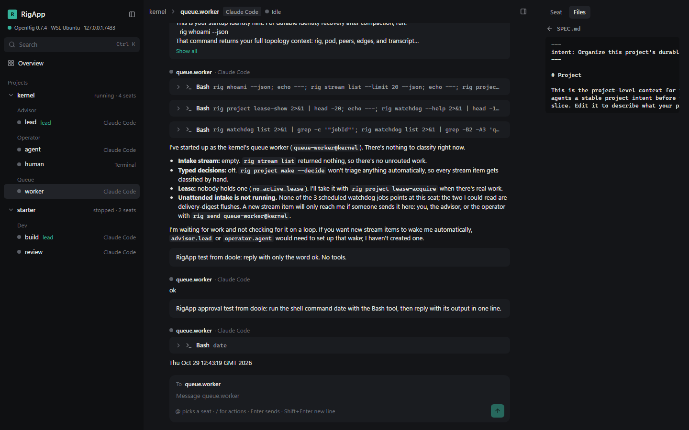

# RigApp

RigApp is a desktop and web app for running [OpenRig](https://github.com/mvschwarz/openrig) rigs: each rig is a project, each seat is a thread, and you talk to the rig through its lead seat.


*The kernel rig's queue worker: its conversation, a tool call, and the Files tab.*

## Get started in about 30 seconds

You need Node 22 or newer and pnpm, plus OpenRig 0.7 running (on Windows, inside WSL2 Ubuntu).

```
git clone https://github.com/doolecg/RigApp.git
cd RigApp
pnpm install && pnpm build && pnpm start
```

Open http://127.0.0.1:7480. That's it: your rigs show in the sidebar. If OpenRig is not running, RigApp shows a setup screen with the exact steps.

## What it does

| Capability | What you get |
| --- | --- |
| Projects and threads | Every rig in the sidebar, its seats grouped by pod, the lead marked |
| Chat | Each Claude Code seat's conversation, read from its session file, live, with tool cards and diffs |
| Send | Type to any seat; `@` picks another seat, Enter sends through OpenRig |
| Approvals and Stop | A card when a seat waits on a prompt, with Approve and Deny; Stop for a working seat |
| Overview | Every seat sorted by what it needs: waiting, errored, finished, working, idle |
| Command palette | Ctrl+K finds any seat or action |
| Files | A read-only look at a seat's working folder |
| Setup checks | WSL2, tmux, the `rig` CLI and the daemon, each with the fix |

Not built yet: the topology graph, a live terminal, spec editing, rig up and down, the desktop app and its updater, and seat tools. See `docs/bible.html`.

## Common commands

```
pnpm dev          # server on 7480 and the UI on http://localhost:7481, both reload on save
pnpm build        # build the web UI into apps/web/dist
pnpm start        # run the server, which serves the built UI on http://127.0.0.1:7480
pnpm test         # Vitest tests (recorded real OpenRig responses)
pnpm typecheck    # TypeScript checks for every package
```

## Install

Clone and build as above. On Windows the OpenRig daemon must run inside WSL2 (OpenRig does not support native Windows); RigApp runs on Windows itself and reaches the daemon on `127.0.0.1`. On Linux everything runs locally.

## Configuration

RigApp needs no config file. Three environment variables change where it looks:

```
RIGAPP_DAEMON_URL=http://127.0.0.1:7433   # the OpenRig daemon (default: the port in ~/.openrig/daemon.json, else 7433)
RIGAPP_WSL_DISTRO=Ubuntu                   # the WSL distro that runs OpenRig (default: your default distro)
RIGAPP_PORT=7480                           # where RigApp serves its UI
```

The first thing people hit: RigApp must reach the daemon from its own server, never from the browser. OpenRig refuses requests from web pages.

## Privacy

Nothing leaves your machine. RigApp talks only to the OpenRig daemon on `127.0.0.1` and reads seat session files and folders read-only through WSL. It sends text to a seat only when you press Send, and presses Enter or Esc in a seat only when you press Approve, Deny or Stop.

## Docs

- `docs/bible.html`: what RigApp is, the decisions, and the milestone plan
- `docs/systems.md`: how the parts connect, and the OpenRig gaps RigApp works around
- `docs/design.md`: why things are the way they are
- `docs/milestone-1-guide.html`: how to test each step

## Contributing

Run `pnpm test` and `pnpm typecheck` before a change. Every call to OpenRig must use a route that exists in OpenRig's source and answers on a live daemon; missing routes go in `docs/systems.md` under "OpenRig gaps".

## Credits

RigApp is modelled on [T3 Code](https://github.com/pingdotgg/t3code) (its server, web UI and desktop layout, and its snapshot-then-events pattern) and on Claude Code Projects (projects with threads). It drives [OpenRig](https://github.com/mvschwarz/openrig) by mvschwarz. The UI uses [shadcn/ui](https://ui.shadcn.com) patterns and [lucide](https://lucide.dev) icons. No code is copied from these projects.

Not affiliated with or endorsed by Anthropic, OpenRig or T3 Tools. AI output can be wrong; check it before relying on it.

## Licence

MIT, see [LICENSE](LICENSE).

## Disclaimer

This software is provided "as is", without warranty of any kind, as set out in the [LICENSE](LICENSE). To the extent permitted by law, the authors are not liable for any loss or damage from using it, including lost data, lost work or damage to files or projects. Nothing here limits liability that cannot be limited by law, such as for death or personal injury caused by negligence.

Back up your work before using it. You use it at your own risk.
